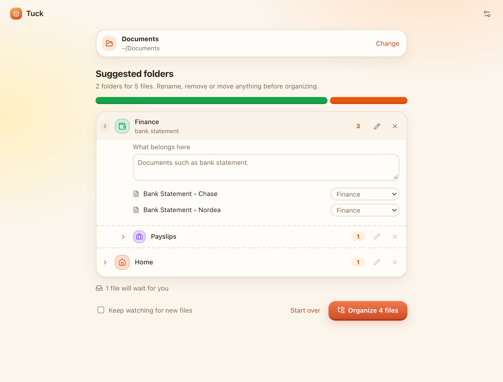
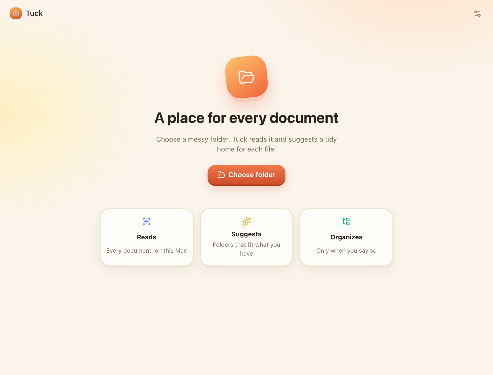
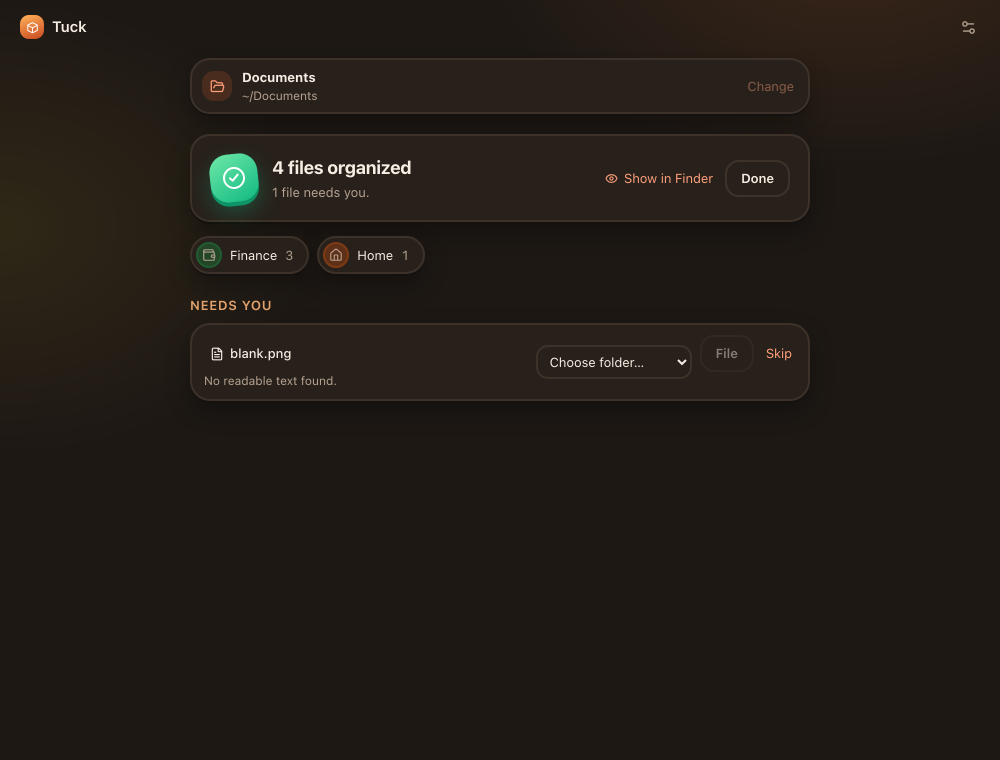
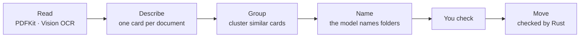

# Tuck

**A place for every document.** Tuck is a macOS app that reads a messy folder of PDFs, scans and
photos on your Mac, suggests a tidy set of folders, and moves everything into place when you say
so. With Apple Intelligence it runs entirely on device: no account, no cloud, no database.

<p align="center">
  
</p>

<p align="center">
  
  
</p>

## Install

Tuck runs on **macOS 26 or later on an Apple silicon Mac** (M1 or newer). For on-device AI, turn on
Apple Intelligence in **System Settings → Apple Intelligence & Siri**. Without it, you can connect
another model in Tuck's Settings instead.

1. Download `Tuck_<version>_aarch64.dmg` from the
   [latest release](https://github.com/Haffaz/tuck/releases/latest).
2. Open the `.dmg` and drag **Tuck** into **Applications**.
3. Open Tuck from Applications. The first time, macOS says it could not verify the app, because
   Tuck is not yet notarized by Apple. Click **Done**, open **System Settings → Privacy & Security**,
   scroll to **Security** and click **Open Anyway** next to Tuck, then confirm. macOS remembers this.

If you prefer Terminal, this removes the download quarantine flag instead of step 3:

```sh
xattr -dr com.apple.quarantine /Applications/Tuck.app
```

Each release also lists SHA-256 checksums. To check a download, run this in the folder that holds
both files:

```sh
shasum -a 256 -c SHA256SUMS.txt --ignore-missing
```

**Update:** download the new `.dmg` and replace Tuck in Applications. Your folder rules and settings
live next to your documents and are kept. **Uninstall:** move Tuck to the Trash. To remove its small
preferences file too, delete `~/Library/Application Support/app.tuck.desktop`.

## What it does

1. **Choose a folder.** Tuck reads every document in it: PDF text, OCR for scans, labels for photos.
2. **Check the suggestion.** Folders such as Finance, Home and Health appear with their file counts.
   Rename or remove a folder, move a file, or edit what belongs where. Nothing has moved yet.
3. **Organize.** Folders are created and files move in one step, renamed like
   `Bank Statement - Nordea - 2026-03`. Anything Tuck is unsure about waits for you.

Tick **Keep watching for new files** and new downloads are filed as they arrive.

## How it works



- Each document gets a **card**: its kind, issuer, date and three tags, plus a sentence embedding.
- Documents are **grouped mathematically** on those embeddings. The model only names the groups, so
  one odd answer cannot scatter your files.
- **Rust owns every file operation.** Each move re-checks the file and never overwrites anything.
- **Unreadable scans are not guessed.** Low OCR confidence sends a file to you instead.

More detail is in [docs/architecture.md](docs/architecture.md).

## Built with

| Layer                   | Technology                                                                                                             |
| ----------------------- | ---------------------------------------------------------------------------------------------------------------------- |
| App shell               | [Tauri 2](https://tauri.app)                                                                                           |
| Interface               | React 19, TypeScript, Vite, [Lucide](https://lucide.dev) icons                                                         |
| Core                    | Rust: session, clustering, file operations, FSEvents watching (`notify`)                                               |
| On-device AI            | Apple **Foundation Models** (Apple Intelligence), **NaturalLanguage** sentence embeddings                              |
| Reading                 | **PDFKit**, **Vision** document and text recognition, face and barcode detection, image classification, **Core Image** |
| macOS                   | **Quick Look** preview, security-scoped bookmarks, **Keychain**                                                        |
| Other models (optional) | Ollama, any OpenAI-compatible API, Anthropic, via custom connections in Settings                                       |
| Tests                   | Rust unit tests, Swift checks, Playwright UI tests, synthetic evaluation corpora                                       |

The Swift parts are two small command-line helpers and a static library, compiled by `build.rs`,
because Apple's frameworks are reachable only from Swift. Rust talks to the helpers with one JSON
request per process.

## Privacy

- With Apple Intelligence, documents never leave your Mac.
- With a custom connection, the extracted text of each document (first 5,000 characters) is sent to
  the endpoint you choose. API keys live in the macOS Keychain.
- Folder rules and settings are plain files in a `.tuck` folder next to your documents. A rebuildable
  cache of document cards lives there too. Nothing else is stored.

## Build from source

You need macOS 26 or later on Apple silicon, Xcode 27 or later (or its command-line tools) for
`swiftc` and the macOS 27 SDK, Rust (stable) and Node.js 20 or later.

```sh
npm install
npm run tauri dev      # run the app; the Swift helpers are compiled on first build
npm run tauri build    # Tuck.app and a .dmg in src-tauri/target/release/bundle
```

## Tests

```sh
npm run check          # frontend build, clippy, Rust tests, Swift checks, Playwright UI tests
npm run test:contracts # custom-connection protocols against local mock servers
npm run screenshots    # regenerate the images in docs/images
```

UI tests run the real interface against a mocked Tauri bridge, so they need no model. Evaluations
that call Apple Intelligence are opt-in (`cargo test -- --ignored`) and use synthetic documents; see
[evals/cards](evals/cards/README.md) for the corpora and results.

## Releases

GitHub Actions runs `npm run check` on every pull request and push to `main`
([ci.yml](.github/workflows/ci.yml)). To publish a version:

```sh
npm run version:set 0.2.0      # package.json, package-lock.json, tauri.conf.json, Cargo.toml, Cargo.lock
git commit -am "chore: release 0.2.0"
git tag v0.2.0
git push origin main v0.2.0
```

The tag starts [release.yml](.github/workflows/release.yml). It checks that the tag matches the
version, runs the tests, builds the app, and publishes a GitHub release with the `.dmg`, a zipped
`Tuck.app` and `SHA256SUMS.txt`. A version with a suffix such as `0.2.0-beta.1` becomes a
pre-release. Running the workflow by hand builds the same files as a workflow artifact without
publishing.

Builds are ad-hoc signed, not notarized, which is why the first launch needs **Open Anyway**.
Notarization needs an Apple Developer ID certificate.

## Project layout

```text
src/                      React interface: App.tsx, screens/, components/
src-tauri/src/            Rust core
  engine/                 session, filing queue, organizing
  reader.rs               reading documents and clues
  cards.rs                document cards and their cache
  suggest.rs, cluster.rs  folder suggestions
  filing.rs               filing decisions
  files.rs                checked file operations
src-tauri/swift/          Swift helpers: reader, model helper, macOS integration
evals/                    synthetic corpora and evaluation scripts
tests/                    Playwright UI tests
docs/                     architecture and design notes
```

## Limits

Up to 2,000 documents per session; PDF, PNG, JPEG, HEIC, TIFF, text and Markdown up to 100 MB each.
Cards read the first 5,000 characters. At most two folder levels. The model can still make a
plausible mistake, so review the suggestion before organizing.

## Acknowledgements

Icons, and the shape of the app icon, come from [Lucide](https://lucide.dev) (ISC license). The
card-and-cluster approach started as a small prototype called FolderSort.

## License

A license will be added before the first public release.
