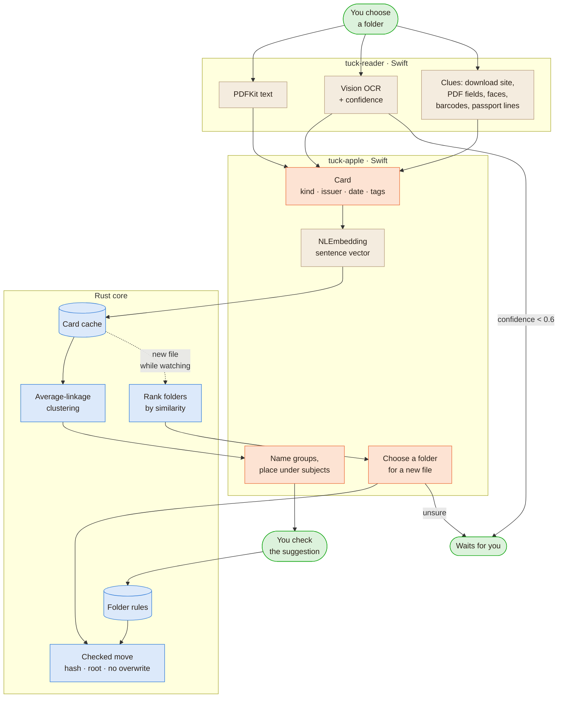
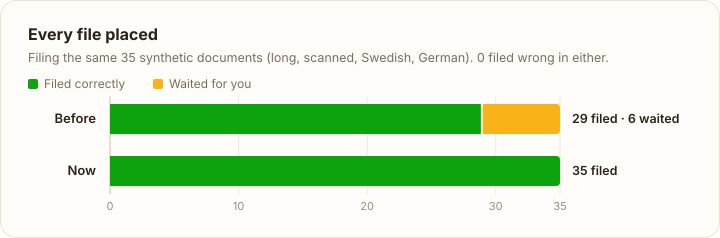
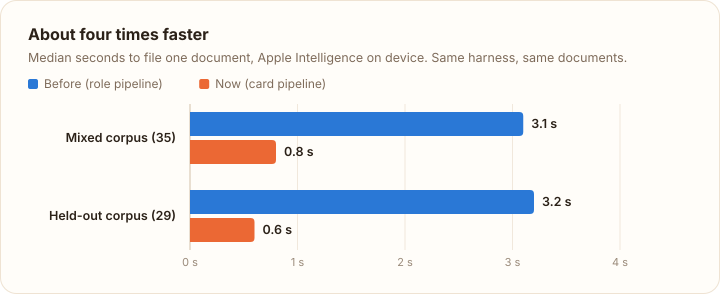
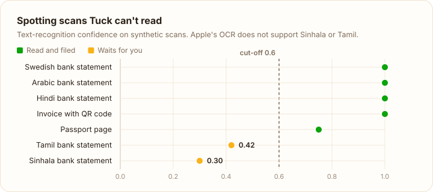

# Tuck

**A place for every document.** Tuck is a macOS app that reads a messy folder of PDFs, scans and
photos on your Mac, suggests a tidy set of folders, and moves everything into place when you say
so. With Apple Intelligence it runs entirely on device: no account, no cloud, no database.

<p align="center">
  
</p>

<p align="center">
  
  
</p>

## What it does

1. **Choose a folder.** Tuck reads every document in it: PDF text, OCR for scans, labels for photos.
2. **Check the suggestion.** Folders such as Finance, Home and Health appear with their file counts.
   Rename or remove a folder, move a file, or edit what belongs where. Nothing has moved yet.
3. **Organize.** Folders are created and files move in one step, renamed like
   `Bank Statement - Nordea - 2026-03`. Anything Tuck is unsure about waits for you.

Tick **Keep watching for new files** and new downloads are filed as they arrive.

## How it works



Orange steps call the language model; everything else is deterministic code. The model only
returns short pieces of text, and Rust decides what happens to files.

- Each document gets a **card**: what kind of document it is, who issued it, its date and three
  tags, written by the language model, plus a sentence embedding from Apple's NaturalLanguage
  framework.
- Documents are **grouped mathematically**, with average-linkage clustering on those embeddings. The
  model only names the groups and places them under broad subjects, so one odd answer cannot
  scatter your files.
- **Rust owns every file operation.** The models return short pieces of data and never touch files.
  Each move re-checks the file's hash, the destination and the root, and never overwrites anything.
- **Unreadable scans are not guessed.** Low text-recognition confidence (for scripts Apple's OCR does
  not support) sends a file to you instead.
- **Local clues** help with thin documents: the site a file was downloaded from, PDF properties and
  form fields, a photo of a person, barcodes, and passport machine-readable lines.

The full story, with diagrams, is in [docs/architecture.md](docs/architecture.md).

## Results

Measured on synthetic documents with Apple Intelligence, using the same harness for the earlier
design and the current one. These are small test sets, not a real-world accuracy estimate.

<picture>
  <source media="(prefers-color-scheme: dark)" srcset="docs/images/charts/placed-dark.svg">
  
</picture>

<picture>
  <source media="(prefers-color-scheme: dark)" srcset="docs/images/charts/faster-dark.svg">
  
</picture>

<picture>
  <source media="(prefers-color-scheme: dark)" srcset="docs/images/charts/confidence-dark.svg">
  
</picture>

| Measure                                                | Before (role pipeline) | Now (card pipeline) |
| ------------------------------------------------------ | ---------------------- | ------------------- |
| Mixed corpus (35): filed correctly / wrong / waited    | 29 / 0 / 6             | 35 / 0 / 0          |
| Held-out corpus: clear documents filed correctly       | 25 / 25                | 25 / 25             |
| Median seconds to file one document (mixed / held-out) | 3.1 / 3.2              | 0.8 / 0.6           |
| Unreadable Sinhala and Tamil scans                     | guessed                | wait for you        |

The current design places more and asks less: of four deliberately ambiguous held-out documents it
holds one for review, where the old design held all four. Details and method are in
[evals/cards](evals/cards/README.md); the charts are drawn by
[docs/charts/make_charts.py](docs/charts/make_charts.py).

## Built with

| Layer                   | Technology                                                                                                             |
| ----------------------- | ---------------------------------------------------------------------------------------------------------------------- |
| App shell               | [Tauri 2](https://tauri.app)                                                                                           |
| Interface               | React 19, TypeScript, Vite, [Lucide](https://lucide.dev) icons                                                         |
| Core                    | Rust: session, clustering, file operations, FSEvents watching (`notify`)                                               |
| On-device AI            | Apple **Foundation Models** (Apple Intelligence), **NaturalLanguage** sentence embeddings                              |
| Reading                 | **PDFKit**, **Vision** document and text recognition, face and barcode detection, image classification, **Core Image** |
| macOS                   | **Quick Look** preview, security-scoped bookmarks, **Keychain**                                                        |
| Other models (optional) | Ollama, any OpenAI-compatible API, Anthropic, via [custom connections](docs/model-connections.md)                      |
| Tests                   | Rust unit tests, Swift checks, Playwright UI tests, synthetic evaluation corpora                                       |

The Swift parts are two small command-line helpers and a static library, compiled by `build.rs`,
because Apple's frameworks are reachable only from Swift. Rust talks to the helpers with one JSON
request per process.

## Privacy

- With Apple Intelligence, documents never leave your Mac.
- With a custom connection, the extracted text of each document (first 5,000 characters) is sent to
  the endpoint you choose. API keys live in the macOS Keychain.
- Folder rules and settings are plain files in a `.tuck` folder next to your documents. A rebuildable
  cache of document cards lives there too. Nothing else is stored.

## Requirements

- macOS 26 or later on Apple silicon, with Apple Intelligence turned on (or a custom connection)
- Xcode 26 or later (or its command-line tools) for `swiftc`
- Rust (stable) and Node.js 20 or later

## Build and run

```sh
npm install
npm run tauri dev      # run the app; the Swift helpers are compiled on first build
npm run tauri build    # Tuck.app and a .dmg in src-tauri/target/release/bundle
```

## Tests

```sh
npm run check          # frontend build, clippy, Rust tests, Swift checks, Playwright UI tests
npm run test:contracts # custom-connection protocols against local mock servers
npm run screenshots    # regenerate the images in docs/images
```

UI tests run the real interface against a mocked Tauri bridge, so they need no model. Evaluations
that call Apple Intelligence are opt-in (`cargo test -- --ignored`) and use synthetic documents; see
[evals/cards](evals/cards/README.md) for the corpora and results.

## Project layout

```text
src/                      React interface: App.tsx, screens/, components/
src-tauri/src/            Rust core
  engine/                 session, filing queue, organizing
  reader.rs               reading documents and clues
  cards.rs                document cards and their cache
  suggest.rs, cluster.rs  folder suggestions
  filing.rs               filing decisions
  files.rs                checked file operations
src-tauri/swift/          Swift helpers: reader, model helper, macOS integration
evals/                    synthetic corpora and evaluation scripts
tests/                    Playwright UI tests
docs/                     architecture and design notes
```

## Documentation

- [Architecture](docs/architecture.md): components, reading, cards, suggesting, filing, safety.
- [Native macOS integration](docs/native-macos.md): the Apple frameworks used and how.
- [Model connections](docs/model-connections.md): using Ollama, OpenAI-compatible or Anthropic models.
- [Folder rules](docs/folder-rules.md): the `.tuck` files you can read and edit.
- [History](docs/history.md): the earlier design, what changed, and lessons learned.

## Limits

Up to 2,000 documents per session; PDF, PNG, JPEG, HEIC, TIFF, text and Markdown up to 100 MB each.
Cards read the first 5,000 characters. At most two folder levels. The model can still make a
plausible mistake, so review the suggestion before organizing.

## Acknowledgements

Icons, and the shape of the app icon, come from [Lucide](https://lucide.dev) (ISC license). The
card-and-cluster approach started as a small prototype called FolderSort; see
[docs/history.md](docs/history.md).

## License

A license will be added before the first public release.
