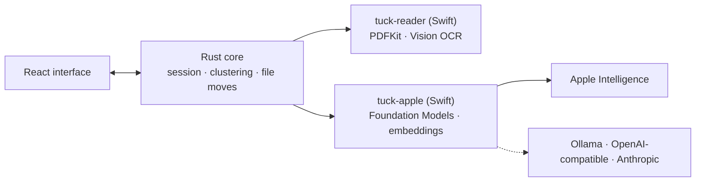

# Architecture

Tuck is a [Tauri 2](https://tauri.app) app: a React interface, a Rust core that owns every file
operation, and two small Swift programs for the Apple frameworks Rust cannot call directly. The
models never touch files. They return short pieces of data, and Rust checks each answer before
anything moves.

Each Swift request is a fresh process that reads one JSON request and writes one JSON reply, with a
deadline and an output cap.

## Reading

- **PDFs**: PDFKit text, up to 12 pages. Pages with almost no text are read with Vision OCR.
- **Images**: Vision OCR. Photos with little text get image labels ("beach", "dog") instead.
- **Unreadable scans**: OCR confidence below 0.6 (for example Sinhala or Tamil, which Apple's OCR does
  not support) sends the file to you instead of guessing from garbled text.
- **Clues**: the site a file was downloaded from, PDF properties and form fields, a photo of a
  person, barcodes, and passport machine-readable lines.

## Cards and suggestions

Every document gets a **card**: its kind ("bank statement"), issuer, date and three tags, written by
the model in English, plus a sentence embedding from Apple's NaturalLanguage framework. Cards are
cached in `.tuck/cache/cards/` by content hash.

To suggest folders, Rust clusters the cards by embedding (average linkage, cosine ≥ 0.75). The model
only names each group and places the groups under broad subjects such as Finance or Home, so one bad
reply changes a name, not which documents belong together.

## Filing and safety

New files are ranked against the existing folders by embedding, and the model picks one of the
closest few or answers "None of these", in which case the file waits for you. Files are renamed
`Kind - Issuer - Date`, keeping the issuer and date only when the text contains them.

Every move re-checks the file's hash, that the destination is an enabled folder inside the chosen
root, and never overwrites an existing file.

## What is stored

There is no database. Everything lives in a `.tuck` folder next to your documents:

| Location                         | Contents                                             |
| -------------------------------- | ---------------------------------------------------- |
| `.tuck/settings.json`            | Model choice, folder levels, renaming                |
| `.tuck/instructions.md`          | Filing instructions for every document               |
| `<folder>/.tuck/instructions.md` | That folder's rule in plain text: what belongs in it |
| `.tuck/cache/cards/`             | Rebuildable document cards                           |
| macOS Keychain                   | API keys for custom connections                      |

With a custom connection, the first 5,000 characters of each document are sent to the endpoint you
choose.

## Code map

| Area                       | Files                                                                        |
| -------------------------- | ---------------------------------------------------------------------------- |
| Interface                  | `src/App.tsx`, `src/screens/`, `src/components/`                             |
| Session, queue, organizing | `src-tauri/src/engine/`                                                      |
| Reading                    | `src-tauri/src/reader.rs`, `swift/TuckReader.swift`, `TuckClues.swift`       |
| Cards and suggestions      | `cards.rs`, `suggest.rs`, `cluster.rs`, `swift/TuckCards.swift`              |
| Filing and file moves      | `filing.rs`, `files.rs`                                                      |
| Models                     | `provider.rs`, `helper.rs`, `swift/TuckApple.swift`, `TuckConnections.swift` |
| macOS                      | `native.rs`, `watching.rs`, `swift/TuckMac.swift`                            |
