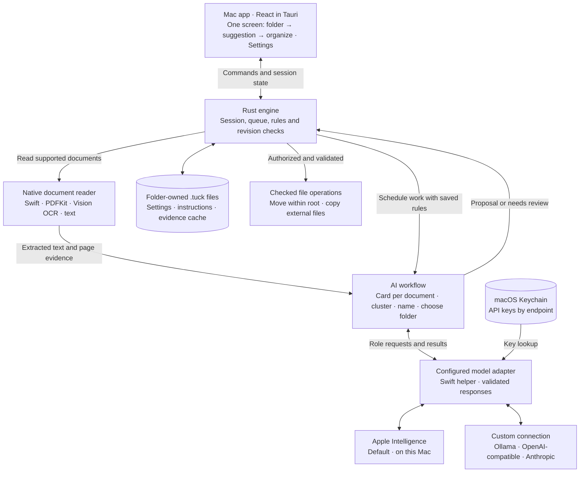
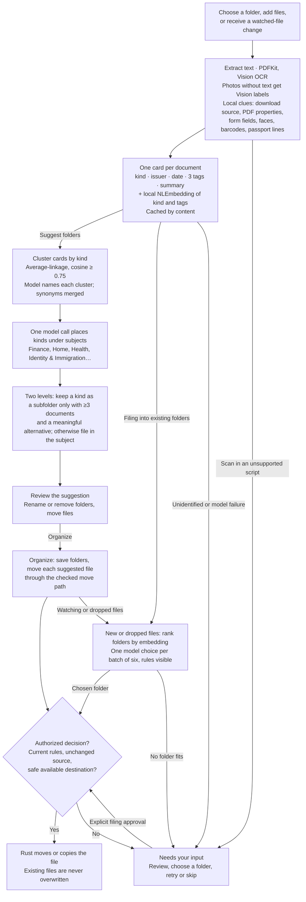

# How Tuck works

Current implementation, checked against the source on 10 October 2026.

Tuck reads documents, proposes a filing decision, and checks that decision before changing files. You choose the folder structure and start the filing session. The AI returns suggestions; Rust owns the file operations.

## Main components

Apple processes text on this Mac. Custom connections receive extracted text and the instructions needed for the requested role; their endpoint may be local or remote. Models receive no file-writing tools. There is no automatic provider fallback. Older fixed Gemma configurations remain supported through the legacy local adapter.

## From documents to folders

Reading also collects local clues that are not in the text: the domain a file was downloaded from or emailed by (macOS "Where from"; never the full link or address), PDF title, author, subject, creator and form field names, and on page 1 whether there is a photo of a person, a barcode or QR code (payment and boarding-pass codes are named, not copied) or a passport/ID machine-readable zone. Clues go to the describing model in a separate block and are part of the card cache key; files without clues get the same prompt as before. Scans whose text recognition confidence is low (unsupported scripts such as Sinhala and Tamil score 0.30–0.42, readable pages 0.75–1.0) go to review instead of being described from garbled text, as do cards whose kind is only "unknown" or "document".

Grouping is deterministic once cards exist. The model writes cards, names groups, places kinds under subjects and chooses among folders; a failed naming or subject reply degrades a name, not a document's placement. Long documents are read from the start (first 5,000 characters) instead of being rejected. Apple's guardrails still apply to guided output in permissive mode, so cards and folder choices fall back to plain-text replies when guided output is blocked; identity, tax and immigration papers otherwise fail routinely. Filenames are built from the card as `Kind - Issuer - Date`; the issuer and date are kept only when the document text contains them.

A suggestion creates no folders and moves nothing until you click Organize; then the files it placed move in one step and the rest wait for you. Optional watching lasts only for the active session.

## Nesting and the three rules

| Control                         | Used for                                                                                                     | Example                                           |
| ------------------------------- | ------------------------------------------------------------------------------------------------------------ | ------------------------------------------------- |
| **Document instructions**       | General filing and naming preferences. Combined with applicable folder rules.                                | Use short English filenames.                      |
| **Folder creation preferences** | Grouping documents when proposing a new folder structure. Within the selected nesting limit.                 | Group by project, supplier or product.            |
| **What belongs here?**          | Matching and checking a document against a particular folder. Parent folder rules are inherited by children. | Inspection reports for project Orion belong here. |

The nesting setting is a maximum: one or two levels including the subject. Missing facts stay in a broader folder. Arbitrary source fields can define grouping; there is no employer-specific hierarchy. Changing folder creation preferences does not reorganize existing folders. Edits remain drafts until Save; saved settings and instructions are checked again before filing. Changing the model or saved rules stops the active filing session and requires fresh analysis.

## What is stored

| Location                              | Contents                                                                                                         |
| ------------------------------------- | ---------------------------------------------------------------------------------------------------------------- |
| Root `.tuck/settings.json`            | Model connection, folder nesting, folder creation preferences and other persisted settings. No API key.          |
| Root `.tuck/instructions.md`          | Document instructions.                                                                                           |
| Each folder's `.tuck/instructions.md` | Folder rule, complete accepted types, scope hash, saved examples, enabled state and priority.                    |
| Root `.tuck/cache/cards/`             | Rebuildable document cards and embeddings, keyed by content, extracted text and model/helper identity.           |
| macOS Keychain                        | Connection API keys, scoped to the connection type and endpoint.                                                 |
| App memory                            | Collection map, queue, review decisions, activity and watch authorization. These are not resumed after quitting. |

The app also remembers the last selected root in Application Support. There is no database, persistent undo or durable file-operation journal. An interrupted move can leave a duplicate; restart does not automatically delete or replay it.

## Code map

| Responsibility                            | Main files                                                                |
| ----------------------------------------- | ------------------------------------------------------------------------- |
| Screens and settings                      | `src/App.tsx`, `src/Home.tsx`, `src/Settings.tsx`                         |
| Tauri commands and session lifecycle      | `src-tauri/src/lib.rs`, `src-tauri/src/engine.rs`                         |
| Document extraction                       | `src-tauri/swift/TuckReader.swift`, `src-tauri/src/classifier.rs`         |
| Cards and their cache                     | `src-tauri/src/cards.rs`, `src-tauri/swift/TuckCards.swift`               |
| Folder suggestions                        | `src-tauri/src/card_suggest.rs`, `src-tauri/src/cluster.rs`               |
| Filing                                    | `src-tauri/src/card_filing.rs`                                            |
| Provider selection and request contracts  | `src-tauri/src/provider.rs`                                               |
| Custom APIs and Keychain                  | `src-tauri/swift/TuckConnections.swift`                                   |
| Settings, inherited rules and file writes | `src-tauri/src/config.rs`, `instructions.rs`, `files.rs`                  |

Valid output and a chosen folder do not guarantee a semantically correct classification; review the draft before approving it.

## Work and compatibility limits

New suggestions and active destinations have at most two levels and 40 folders. Old three-level rule files remain on disk and are excluded from active destinations. Cards read the first 5,000 characters (2,500 when dense text exceeds the model's context). Embeddings come from Apple's English sentence model; cards are written in English, so non-English documents group by their English description. Clustering is O(n³) and comfortable up to roughly 1,000 documents. Filing compares at most six folders per model call; the Rust filing deadline remains 90 seconds per document.

Folder creation preferences are passed to folder naming and subject placement; they cannot force a grouping field (for example "group invoices by supplier"), which the previous pipeline supported.
