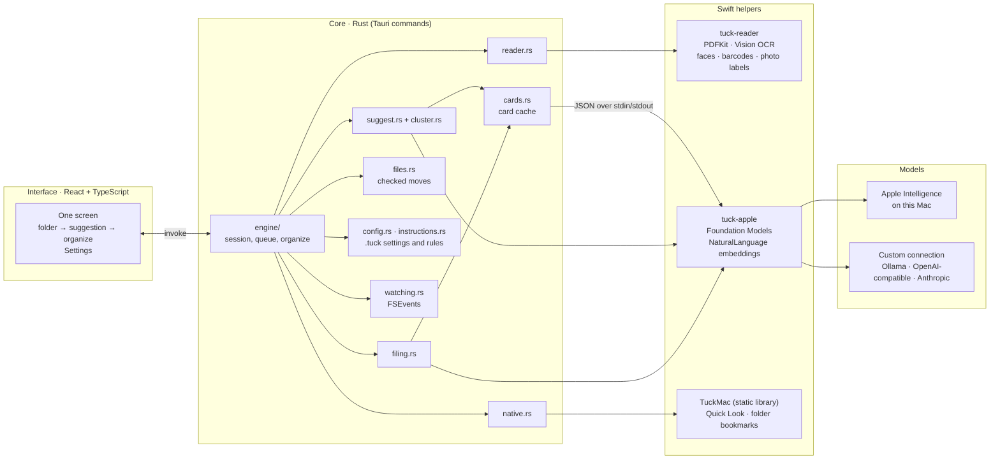
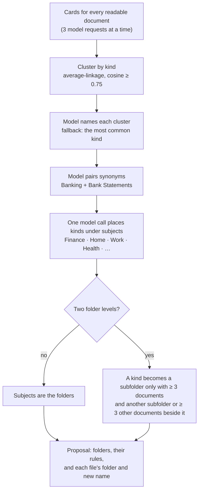
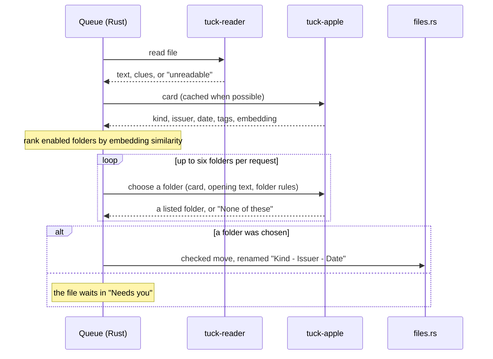

# Architecture

Tuck is a macOS app that reads a folder of documents on your Mac, suggests folders for them and
moves them when you approve. It is a [Tauri 2](https://tauri.app) app: a React interface, a Rust
core that owns every file operation, and two small Swift programs that reach Apple frameworks
Rust cannot call directly.

The models never touch files. They return short pieces of data (a description of a document, a
folder name, a choice from a list), and Rust checks each answer before anything moves.

## Components

| Part | Technology | Responsibility |
| --- | --- | --- |
| Interface | React 19, TypeScript, Vite | Screens and drafts; it calls Rust through Tauri commands and polls the session state once a second |
| Core | Rust, Tauri 2 | Session state, scanning, the filing queue, every file operation and its checks |
| `tuck-reader` | Swift: PDFKit, Vision, ImageIO | Text from PDFs, OCR for scans and photos, text-recognition confidence, photo labels, file clues |
| `tuck-apple` | Swift: Foundation Models, NaturalLanguage, URLSession, Security | Model requests (Apple or custom), sentence embeddings, API keys in Keychain |
| `TuckMac` | Swift: AppKit, Quick Look | Document preview and security-scoped folder bookmarks, linked into the app |

Both Swift helpers are separate executables. Each request starts a fresh process that reads one JSON
request and writes one JSON reply, with a deadline and an output cap. That keeps the model and OCR
code out of the app process and makes each request independent.

## Reading a document

`reader.rs` runs `tuck-reader` on each file, four at a time.

- **PDFs**: PDFKit text for each page, up to 12 pages. Pages with almost no text are rendered and
  read with Vision's document recognition, which keeps paragraphs, lists and table cells.
- **Images**: oriented and read with Vision; a skewed photo of a page is straightened with Core
  Image first. If there is almost no text, Vision's image classifier labels what the picture shows,
  so photos can still be grouped.
- **Text and Markdown**: read directly by Rust.

**Unreadable scans.** OCR reports a confidence for each line. When the fast document API scores a
page below 0.6, the classic recogniser checks it again. Readable pages score 0.75–1.0, while
scripts Vision does not support (such as Sinhala or Tamil) score 0.30–0.42. Such scans go to the
user with a reason instead of being described from garbled text.

**File clues.** The reader also collects facts that are not in the text and passes them to the
model in a separate block:

| Clue | Source |
| --- | --- |
| Downloaded from or sent by (domain only) | the `kMDItemWhereFroms` extended attribute that Safari and Mail write |
| PDF title, subject, author, creator, producer | PDF document attributes |
| Form field names | PDF widget annotations |
| Photo of a person | Vision face detection on page 1 |
| Barcodes and QR codes | Vision barcode detection; payment and boarding-pass codes are named, never copied |
| Passport or ID machine-readable zone | the ICAO 9303 lines in the recognised text |

## Cards

Every document gets one **card**: what kind of document it is ("bank statement"), who issued it,
its main date and three topic tags. `tuck-apple` asks the model for the card in one guided call and
computes a sentence embedding of the kind and tags with Apple's NaturalLanguage framework.

- Only the first 5,000 characters are read; long documents are read from the start rather than
  rejected.
- Cards are written in English whatever the document's language, so a Swedish and an English bank
  statement look alike.
- When guided output is refused (Apple applies guardrails to guided generation even in its
  permissive mode), the helper asks again for a fixed plain-text format and parses it.
- A card whose kind is only "unknown" or "document" counts as unidentified, and the file waits for
  the user.
- Cards are cached in `.tuck/cache/cards/`, keyed by the file's content hash, the extracted text and
  clues, and the model and helper build. A second suggestion skips this step.

## Suggesting folders

Grouping itself is deterministic. The model only names groups and places them under subjects, so a
bad reply changes a name, not which documents belong together. Embeddings separate kinds well
(same kind from different issuers ≈ 0.8, different kinds 0.55–0.73) but cannot tell that a payslip
and an employment contract both belong under work, which is why one model call adds the subjects.

Each folder gets a rule built from the kinds inside it, for example "Documents such as bank
statement, credit card statement." The user can rename or remove folders, move files and edit the
rules before organizing.

## Organizing

**Organize** saves the folders and their rules, then moves each suggested file in one step
(`engine/organize.rs`). Every move goes through the same checks as a manual one:

- the folder is an enabled rule within two levels, and the name contains no path characters;
- the source still has the hash it had when it was read;
- the root has not moved, and the destination is inside it;
- an existing file is never overwritten; a free name such as `Bank Statement 2.pdf` is chosen just
  before the move;
- a failure is recorded on that file, and the other files still move.

Files outside the chosen folder (dropped onto the window) are copied, not moved.

## Filing new documents

After organizing, Tuck keeps running: dropped files, **Organize new files** and, if enabled, the
folder watcher put documents in a queue that is read and filed one at a time
(`engine/queue.rs`, `filing.rs`).

The folder choice is a plain-text answer matched against the listed names. Guided choice was both
blocked by guardrails for some documents and erratic. The filename uses the card, and keeps the
issuer and date only when the document text contains them, so a model cannot invent names into
filenames.

**Watching** uses FSEvents through the `notify` crate. A changed file must keep the same size and
modification time for six seconds before it is read; idle folders are rescanned every minute in
case an event was missed, and Tuck's own moves are recorded so they are not filed again.

## Concurrency

- Reading runs four documents at a time and card generation three at a time (`parallel.rs`).
  Apple's on-device model serves one request at a time; three overlapping requests still saved
  about a quarter of the wall time, and more saved nothing.
- Whole model workflows hold one lock (`model_lock.rs`), so suggesting, filing and checking a
  connection never interleave.
- The interface polls `get_state` once a second and ignores responses that arrive out of order.

## What is stored

There is no database. Everything lives in the chosen folder, next to the documents.

| Location | Contents |
| --- | --- |
| `.tuck/settings.json` | Model choice and custom connection (without the key), folder levels, renaming, folder preferences |
| `.tuck/instructions.md` | General filing instructions |
| `<folder>/.tuck/instructions.md` | That folder's rule: what belongs in it (see [folder rules](folder-rules.md)) |
| `.tuck/cache/cards/` | Rebuildable cards, keyed by content |
| macOS Keychain | API keys for custom connections, per endpoint |
| App support folder | The last chosen folder and its security-scoped bookmark |

The session (queue, decisions, activity) stays in memory. Quitting Tuck stops watching.

## Code map

| Area | Files |
| --- | --- |
| Interface | `src/App.tsx`, `src/screens/*`, `src/components/*`, `src/folders.ts`, `src/tuck.css` |
| Tauri commands | `src-tauri/src/lib.rs` |
| Session, queue, organizing | `src-tauri/src/engine/{mod,queue,organize}.rs` |
| Reading and clues | `src-tauri/src/reader.rs`, `src-tauri/swift/TuckReader.swift`, `TuckClues.swift` |
| Cards and their cache | `src-tauri/src/cards.rs`, `src-tauri/swift/TuckCards.swift` |
| Suggesting | `src-tauri/src/suggest.rs`, `cluster.rs`, `parallel.rs` |
| Filing | `src-tauri/src/filing.rs` |
| Model helper bridge | `src-tauri/src/provider.rs`, `helper.rs`, `model_lock.rs`, `swift/TuckApple.swift`, `TuckModelSupport.swift`, `TuckModelChoice.swift`, `TuckConnections.swift` |
| Files, settings, rules | `src-tauri/src/files.rs`, `config.rs`, `instructions.rs`, `collection.rs`, `model.rs` |
| macOS integration | `src-tauri/src/native.rs`, `watching.rs`, `swift/TuckMac.swift` |
| Build | `src-tauri/build.rs` compiles the Swift helpers into `src-tauri/resources/` |

## Limits

- Up to 2,000 documents per session and 10,000 entries per scan; documents up to 100 MB.
- PDF, PNG, JPEG, HEIC, TIFF, plain text and Markdown.
- Cards read the first 5,000 characters and up to 12 PDF pages.
- Embeddings use Apple's English sentence model; cards are written in English for that reason.
- At most two folder levels and 40 folders.
- Clustering is O(n³) and comfortable up to about a thousand documents.
