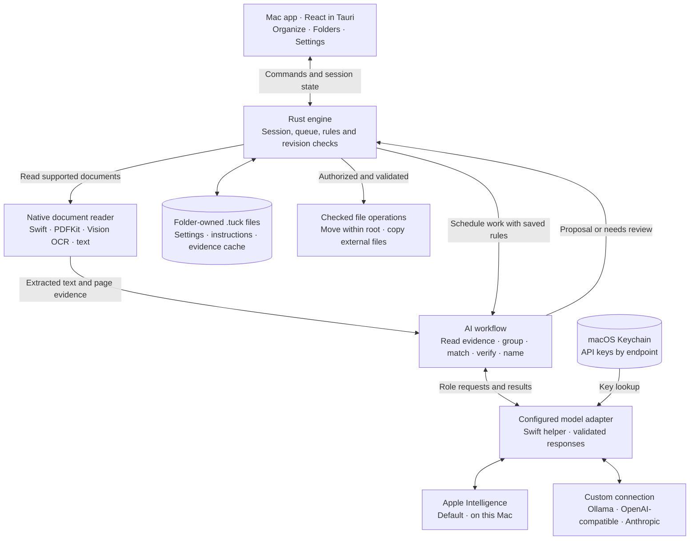
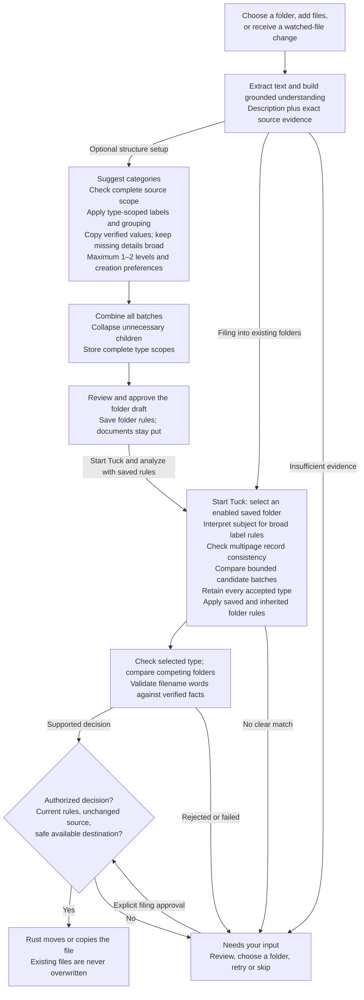

# How Tuck works

Current implementation, checked against the source on 5 October 2026.

Tuck reads documents, proposes a filing decision, and checks that decision before changing files. You choose the folder structure and start the filing session. The AI returns suggestions; Rust owns the file operations.

## Main components

Apple processes text on this Mac. Custom connections receive extracted text and the instructions needed for the requested role; their endpoint may be local or remote. Models receive no file-writing tools. There is no automatic provider fallback. Older fixed Gemma configurations remain supported through the legacy local adapter.

## From documents to folders

Category planning and document filing are separate operations. A category proposal creates no files until you approve it, and approving categories does not start filing. Optional watching lasts only for the active session. Naming failure keeps the original filename rather than discarding a supported folder decision.

## Nesting and the three rules

| Control                         | Used for                                                                                                     | Example                                           |
| ------------------------------- | ------------------------------------------------------------------------------------------------------------ | ------------------------------------------------- |
| **Document instructions**       | General filing and naming preferences. Combined with applicable folder rules.                                | Use short English filenames.                      |
| **Folder creation preferences** | Grouping documents when proposing a new folder structure. Within the selected nesting limit.                 | Group by project, supplier or product.            |
| **What belongs here?**          | Matching and checking a document against a particular folder. Parent folder rules are inherited by children. | Inspection reports for project Orion belong here. |

The nesting setting is a maximum: one or two levels including the subject. Missing facts stay in a broader folder. Arbitrary source fields can define grouping; there is no employer-specific hierarchy. Changing folder creation preferences does not reorganize existing folders. Edits remain drafts until Save; saved settings and instructions are checked again before filing. Changing the model or saved rules stops the active filing session and requires fresh analysis.

## What is stored

| Location                              | Contents                                                                                                         |
| ------------------------------------- | ---------------------------------------------------------------------------------------------------------------- |
| Root `.tuck/settings.json`            | Model connection, folder nesting, folder creation preferences and other persisted settings. No API key.          |
| Root `.tuck/instructions.md`          | Document instructions.                                                                                           |
| Each folder's `.tuck/instructions.md` | Folder rule, complete accepted types, scope hash, saved examples, enabled state and priority.                    |
| Root `.tuck/cache/`                   | Rebuildable descriptions and short verified quotes, keyed by content, extraction and provider identity.          |
| macOS Keychain                        | Connection API keys, scoped to the connection type and endpoint.                                                 |
| App memory                            | Collection map, queue, review decisions, activity and watch authorization. These are not resumed after quitting. |

The app also remembers the last selected root in Application Support. There is no database, persistent undo or durable file-operation journal. An interrupted move can leave a duplicate; restart does not automatically delete or replay it.

## Code map

| Responsibility                            | Main files                                                                                |
| ----------------------------------------- | ----------------------------------------------------------------------------------------- |
| Screens, drafts and folder editor         | `src/App.tsx`, `src/Settings.tsx`, `src/FolderTree.tsx`                                   |
| Tauri commands and session lifecycle      | `src-tauri/src/lib.rs`, `src-tauri/src/engine.rs`                                         |
| Document extraction                       | `src-tauri/swift/TuckReader.swift`, `src-tauri/src/classifier.rs`                         |
| Evidence, cache and filing workflow       | `src-tauri/src/description.rs`, `src-tauri/src/coordinator.rs`                            |
| Folder proposals and coverage checks      | `src-tauri/src/categories.rs`, `src-tauri/src/category_evidence.rs`                       |
| Provider selection and request contracts  | `src-tauri/src/provider.rs`                                                               |
| AI prompts and response validation        | `src-tauri/swift/TuckCategorization.swift`, `TuckRoles.swift`, `TuckRoleValidation.swift` |
| Custom APIs and Keychain                  | `src-tauri/swift/TuckConnections.swift`                                                   |
| Settings, inherited rules and file writes | `src-tauri/src/config.rs`, `instructions.rs`, `files.rs`                                  |

The diagrams describe the current implementation, including conservative review behavior. Valid JSON and a successful verification call do not guarantee a semantically correct classification. Technical budgets and evidence limits remain automatic.

## Work and compatibility limits

New suggestions and active destinations have at most two levels. Old three-level rule files remain on disk and are excluded from active destinations; saving preferences preserves them. Folder planning carries established subject names across batches of up to four documents. Matching compares at most eight candidate scopes per call, uses readable, unique IDs for type alternatives, and compares winners before verifying the chosen destination. A helper operation has a maximum of 32 underlying generations; the Rust filing deadline remains 90 seconds.

Generated rule metadata is persisted separately from the short description. Manual description edits invalidate its hash so stale generated types cannot override an edited scope. The UI lists all included document types. The reader still requires complete short documents; the larger-document limitation is described in [the current workflow](apple-evidence-workflow.md).
